# GEPrep

Prepare game environment assets in Blender: rename, copy, clean up, check, fix and export meshes as GLB without leaving the 3D Viewport sidebar.

> **Blender 5.2 or newer.** Adds a **GEPrep** tab to the sidebar of the 3D Viewport.

<p align="center">
  <br>
  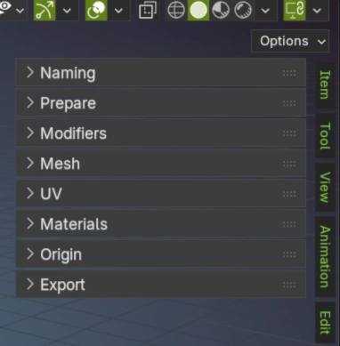
</p>

---

## Contents

- [What it does](#what-it-does)
- [Installation](#installation)
- [The panels](#the-panels)
  - [Naming](#1-naming)
  - [Prepare](#2-prepare)
  - [Modifiers](#3-modifiers)
  - [Mesh](#4-mesh)
  - [UV](#5-uv)
  - [Materials](#6-materials)
  - [Origin](#7-origin)
  - [Export](#8-export)
- [Preferences and updates](#preferences-and-updates)
- [Reading the results](#reading-the-results)
- [Folder structure](#folder-structure)
- [Development](#development)
- [Third-party code](#third-party-code)

---

## What it does

GEPrep follows the order in which you usually get an asset ready for a game engine. The panels in the sidebar are numbered the same way:

| # | Panel | In one line |
|---|-------|-------------|
| 1 | **Naming** | Set, find and replace, or clean up object names |
| 2 | **Prepare** | Make export-ready copies and hide the originals |
| 3 | **Modifiers** | Apply the modifiers that are enabled in the viewport |
| 4 | **Mesh** | Check the geometry for problems and fix them |
| 5 | **UV** | Check and set texel density, orient UVs, preview with a checker |
| 6 | **Materials** | Check materials and textures, remove empty slots |
| 7 | **Origin** | Move the origin to a spot on the bounding box |
| 8 | **Export** | Write the selected meshes to GLB |

Some principles apply to every panel:

- **Checks never change your scene.** Only the buttons that say they change something do, and those support Undo.
- **Findings are not errors.** A check reports what it found. A finding may be intentional, so you decide.
- **Work on the selection.** Every action uses the objects you currently have selected.
- **Results stay visible.** Each action leaves a collapsible report in its panel, and the magnifier button on an entry selects and frames that object.

---

## Installation

1. Download the latest `geprep-x.y.z.zip` from the [Releases](../../releases) page.
2. In Blender open **Edit > Preferences > Add-ons**.
3. Open the drop-down in the top right and choose **Install from Disk…**, then pick the zip.
4. Enable **GEPrep**.

After that, GEPrep can update itself from GitHub, see [Preferences and updates](#preferences-and-updates).

---

## The panels

### 1. Naming

Rename the selected objects.

| Button | What it does |
|--------|--------------|
| **Set New Name** | Gives the selected objects the name you typed |
| **Find & Replace** | Replaces text in the names (case-sensitive). Leave *With* empty to remove the text |
| **Remove Numeric Suffix** | Removes a trailing Blender suffix such as `.001` |

Names that would collide are numbered so every object keeps a unique name, and a rename that would leave a name empty is refused.

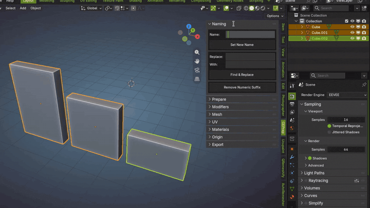

### 2. Prepare

Creates **prepared copies** of your objects so the originals stay untouched.

| Option | Effect |
|--------|--------|
| **Include Children** | Also prepares everything parented under the selection |
| **Add SM_ Prefix** | Names the copies with the `SM_` static-mesh prefix |
| **Number Variants** | Names copies `.001`-style instead of reusing the plain name |
| **Duplicate Materials** | Gives each copy its own materials (texture images stay shared) |
| **Apply Rotation & Scale** | Applies rotation and scale on the copies. Check modifiers afterwards |

- **Prepare Copy** creates the copies and hides the originals.
- **Remove Prepared Copies** deletes the selected copies and brings the originals back, with their original visibility and selection.

The report under the buttons lists each object as *Prepared*, *Restored*, *Skipped* or *Failed*.

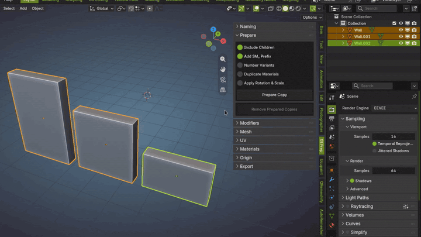

### 3. Modifiers

Shows a preview of every selected object's modifier stack, with a note for modifiers that are disabled in the viewport.

- **Apply Modifiers** applies the modifiers that are enabled in the viewport and keeps the disabled ones.

Objects that cannot be changed safely are skipped with a reason: library data or overrides, meshes with shape keys, animated objects and meshes, and node setups that use simulation zones.

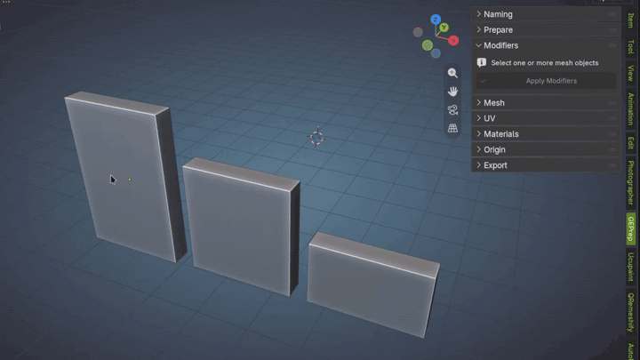

### 4. Mesh

**Geometry Check.** Inspects the base geometry (without modifiers) and counts:

- N-gons
- Loose vertices and loose edges
- Nearby vertices
- Near-zero-length edges
- Small-area faces
- Open boundary edges
- Edges shared by more than two faces
- Non-manifold vertices
- Winding conflicts

**Check Distance** sets how close counts as "nearby". Its square is the small-face area threshold. Click a finding to select the matching geometry in Edit Mode (hidden elements are revealed). **Zoom to selection** and **X-Ray** options help you see it.

**Mesh Fixes.** One button per fix, each working on the selected objects and supporting Undo:

| Fix | What it does |
|-----|--------------|
| **Remove Loose Geometry** | Removes isolated vertices and edges that have no faces |
| **Merge by Distance** | Merges nearby vertices (uses *Merge Distance*) |
| **Dissolve Degenerate Geometry** | Collapses short edges and dissolves degenerate faces (uses *Dissolve Distance*) |
| **Recalculate Normals Outside** | Reorients faces. Inspect open surfaces by hand |
| **Triangulate** | Splits quads and n-gons into triangles |

Merging and dissolving can change faces, UVs and seams, so check the result.

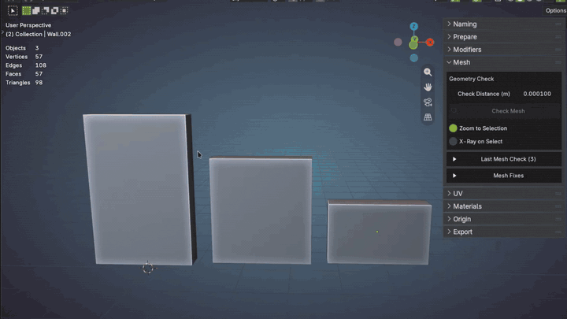
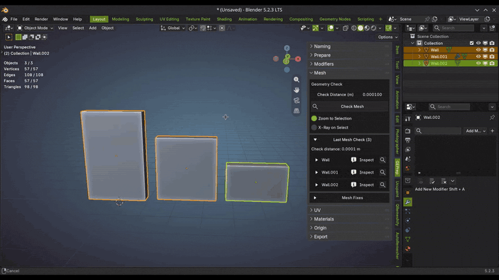


### 5. UV

**Texel Density**

Set the texture size (256 to 8192, or custom width and height), the target density in pixels per metre (128 to 4096, or custom) and a tolerance in percent. Choose a UV map, or leave it empty to use each object's active one.

**Check UVs** reports, per object and UV map:
- the measured density and how many islands are outside the target
- faces outside the 0–1 tile
- overlapping UV faces (estimated on a 512 × 512 grid)
- collapsed UV faces and degenerate mesh faces
- mirrored UV faces
- how much of the tile is covered

> Shader tiling is not measured. Click any reported finding to select the matching faces in Edit Mode. GEPrep will frame them in the UV Editor (toggle this behavior with **Show UV Editor**).

**Set Density** resizes the UV islands to the target density. This can create overlaps or push UVs outside the tile, so repack without rescaling if needed.

**Checker Preview**
- **Checker** shows a 64-pixel UV checker on the selected objects.
- **Direction Checker** adds a cyan +U arrow and an orange +V arrow in every square, which makes rotation and mirroring easy to see.
- **Remove Checker** restores the original materials, including their link type (data or object).

**UV Orientation** (Edit Mode)

Select faces and click an arrow to rotate the whole UV islands touched by the selection so that the cyan +U arrow of the direction checker points that way. *Up Axis* decides which direction counts as up (Auto uses world Z on walls and world Y on floors). *Flatness Tolerance* decides how much an island may bend and still be rotated by its average direction. **●** points +U right and +V up, and **Fix Mirroring** flips mirrored islands without rotating them.

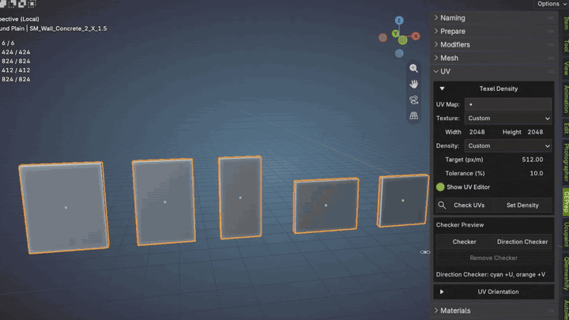

### 6. Materials

**Check Materials** makes no changes. For every selected mesh it checks the material slots and every image texture, including those inside node groups:
- missing files or paths, unloaded or unsaved images
- texture size above *Max Texture Size*, and non-power-of-two sizes
- images that look like copies of another image
- colour space compared with how the colour is used
- UV maps used by textures and normal maps

**Show Node** (the node-tree button on each texture result) selects the object, makes the material slot active and shows the node in a Shader Editor, entering node groups when needed. If you renamed or deleted the node or material since the check, run **Check Materials** again.

**Remove Empty Slots** removes slots that have no material and no faces using them. Filled slots and slots used by faces are always kept.

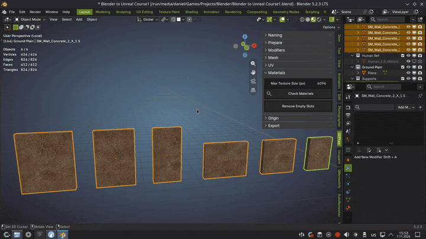

### 7. Origin

Move origins without moving the mesh.

- The 3 × 3 grid chooses a point on the bounding box: corners, edge centres or the centre.
- **Depth** (*Front*, *Center*, *Back*) chooses where along the Y axis. In the front view the front is the lowest Y.
- **Origin to 3D Cursor** moves the origin to the cursor.

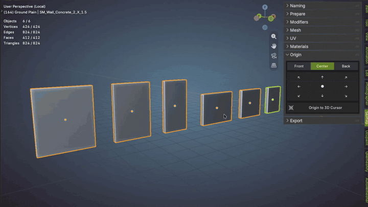

### 8. Export

Writes the selected meshes to GLB (Y up, scene unit scale applied).

| Option | Effect |
|--------|--------|
| **Folder** | Target folder. Start with `//` for a path relative to the saved project |
| **Mode** | *Separate Files*: one file per object, each placed at the origin. *Asset Pack*: all objects in one file, each placed at the origin. *Scene*: all objects in one file, keeping their positions |
| **File Name** | Name of the file for the single-file modes. Empty uses the project name |
| **Include Materials & Textures** | Writes materials and their images into the GLB |
| **Include Tangents** | Writes tangents. Most engines calculate their own, so it only makes files bigger |
| **Overwrite Existing Files** | Replaces files that already exist |

File names are made safe for the file system. The report lists every written file with its path.

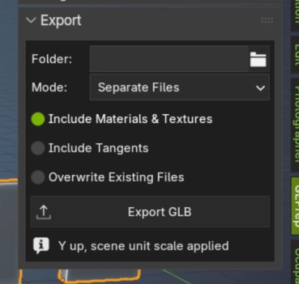

---

## Preferences and updates

Open **Edit > Preferences > Add-ons > GEPrep**.

- **Default Export Folder:** folder used for exported assets.
- **Updater:** check for updates now, or automatically every set number of months, days, hours and minutes (default: weekly). When a newer release exists, GEPrep offers to install it.
- **GitHub Repository** button opens this page.

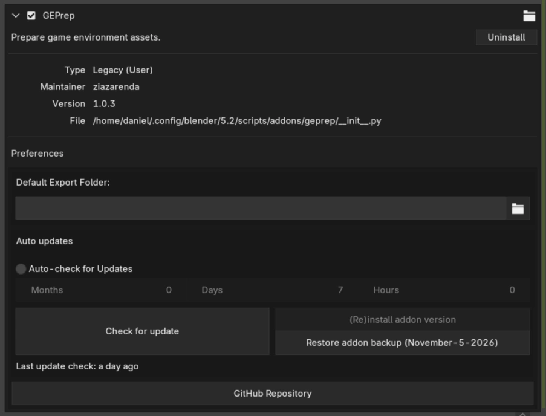

---

## Reading the results

Every report entry has a status:

| Status | Meaning |
|--------|---------|
| ✔ **No Findings** / **Changed** / **Prepared** / **Restored** / **Applied** / **Exported** | It worked, or the check found nothing |
| ℹ **Inspect** | The check found something worth a look. It may be intentional |
| ℹ **Skipped** | Nothing to do, or it was not safe to do |
| ⚠ **Failed** | It could not be done. The message says why |
| ⚠ **Recovery Failed** | A change was interrupted and could not be undone automatically. Use Blender's Undo |

Click the magnifier button on an entry to select that object and frame it in the viewport. Click the entry's name to open or close its details.

---

## Folder structure

```text
geprep/                      the add-on (this is what ends up in the zip)
├── __init__.py              bl_info and register / unregister
├── auto_load.py             finds and registers every Blender class automatically
├── constants.py             add-on id and GitHub details used by the updater
├── preferences.py           the Preferences panel
├── previews.py              loads the icons in resources/
├── addon_updater.py         updater engine (vendored)
├── addon_updater_ops.py     updater operators and UI (vendored)
│
├── settings/                data stored in the .blend file (property groups)
│   ├── scene.py             the main `scene.geprep` settings and every option
│   ├── ui_state.py          expand / collapse state of the panels (not saved)
│   └── prepare.py, mesh.py, uv.py, materials.py, checker.py, ...   result records
│
├── operations/              the real work, as plain functions. No UI code
│   ├── naming.py, prepare.py, modifiers.py, mesh.py
│   ├── uv.py, uv_overlap.py, uv_orientation.py
│   ├── checker.py, direction_checker_pixels.py
│   └── materials.py, origin.py, export.py
│
├── operators/               Blender operators (buttons). Thin: read settings,
│                            call operations/, store the report
│
├── ui/                      sidebar panels and result drawing
│   ├── common.py            shared widgets (action buttons, collapsible boxes)
│   └── naming.py, prepare.py, modifiers.py, mesh.py, uv.py,
│       materials.py, origin.py, export.py
│
├── helpers/                 small shared utilities (object lookups, progress,
│                            finding or opening editors, finding nodes again)
├── resources/icons/         icons used by the add-on
└── vendor/humanize/         third-party library (see below)
```

How the layers fit together, using **Check Mesh** as an example:

1. `ui/mesh.py` draws the button and the report.
2. The button runs the operator in `operators/mesh.py`.
3. The operator calls the check in `operations/mesh.py`.
4. The findings are written to `settings/mesh.py`, and the panel redraws.

Keeping the operations free of UI code is what makes them easy to test.

---

## Development

The repository root also holds the build and test tooling taken from the shared [blender-addon-kit](https://github.com/ziazarenda/blender-addon-kit):

```text
build.py        runs the tests, builds the zip, installs it into a temporary
                Blender profile and runs the Blender tests
tests/plain/    tests that run without Blender
tests/blender/  tests that run inside Blender
.kit.json       records which files come from the kit
```

```bash
uv run python build.py     # tests + build, result in dist/
```

---

## Third-party code

- **humanize**: MIT licence, in `geprep/vendor/humanize/`.
- **Blender Addon Updater** (GPL v2 or later) and **auto_load** (MIT, from [blender_vscode](https://github.com/JacquesLucke/blender_vscode) by Jacques Lucke) come from [blender-addon-kit](https://github.com/ziazarenda/blender-addon-kit). Their notices are in the file headers.

---

## Licence

GPL v3, see the `LICENSE` file.
